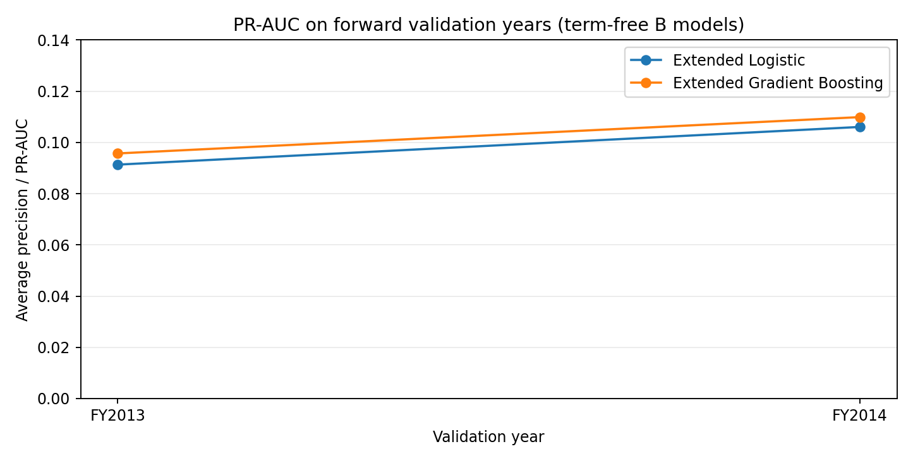
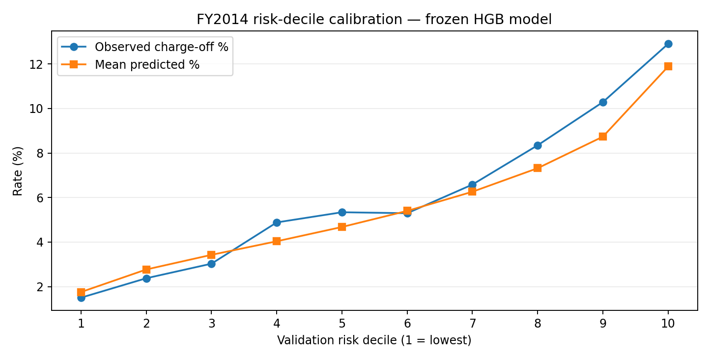

# SBA 7(a) Credit-Risk Analytics and Model Validation

**Status:** published research prototype, with trained models and frozen-cohort validation. **Independent end-to-end reproduction from raw data remains unverified.** Not production-ready and not an approved underwriting score.

## Research goal
Assess whether features in a public historical SBA 7(a) FOIA snapshot can rank **retrospective 120-month charge-off outcomes** in a deliberately selected strict cohort. The study explicitly addresses temporal validation, suspicious term-related signals, potential leakage, feature provenance and calibration. It does **not** establish that the features would have been available exactly as recorded at origination.

## Headline results (development validation, FY2014)

| Model | PR-AUC | ROC-AUC | Brier score |
|---|---:|---:|---:|
| Extended Logistic Regression | 0.1061 | 0.6557 | 0.05587 |
| Extended HistGradientBoosting (provisional primary) | **0.1099** | **0.6695** | **0.05571** |

- Fitting period: FY2010–FY2013, **164,628** loans, **10,856** events.
- Development validation: FY2014, **45,888** loans, **2,778** events (**6.05%**).
- Neither model uses loan term, term-derived features, BusinessAge, terminal loan status or outcome dates.
- The final freeze QA manifest reports all checks passed; archived model hashes have been verified.
- A prior look at FY2015–FY2016 outcomes prevents describing that period as an untouched holdout.





## Repository contents

- `scripts/`: chronological validation, source-lineage investigation and model-freeze scripts.
- `models/`: curated fitted serialized pipelines (.joblib); **never load untrusted joblib files**.
- `results/`: **aggregate-only** run manifests, model metrics, uncertainty, and calibration summaries.
- `figures/`: plots derived exclusively from aggregate outputs.
- `docs/`: detailed methodology, model card, data/feature caveats and reproduction notes.
- `tools/validate_release.py`: verify file integrity and ensure the release excludes common raw-data patterns.

## Quick checks

```powershell
python .\tools\validate_release.py
python -m compileall -q .\scripts
```

To independently re-fit the frozen model, obtain the same **enriched strict FY2010–2014 cohort** from the documented public source and run the workflow in `docs/REPRODUCE.md`. The raw data are deliberately **not included** in this repository. The SHA-256 checksum in the freeze manifest identifies the exact cohort used for this research.

## Read before using results

The strict research cohort is selected using retrospective loan status/term validity, which can introduce selection bias even though term is excluded from the predictors. Source features lack independently verified approval-time versions. Risk calibration is imperfect and subgroup differences remain. No live credit decisions should use this model.

**Further work:** independently test source-to-model reproducibility (including compressed-file checksum behaviour), review public-data terms and code licensing, confirm approval-time feature provenance, and check all narrative claims against the manifests. See `docs/OPEN_QUESTIONS.md`.
