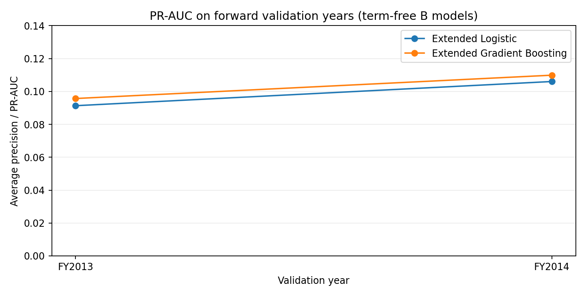
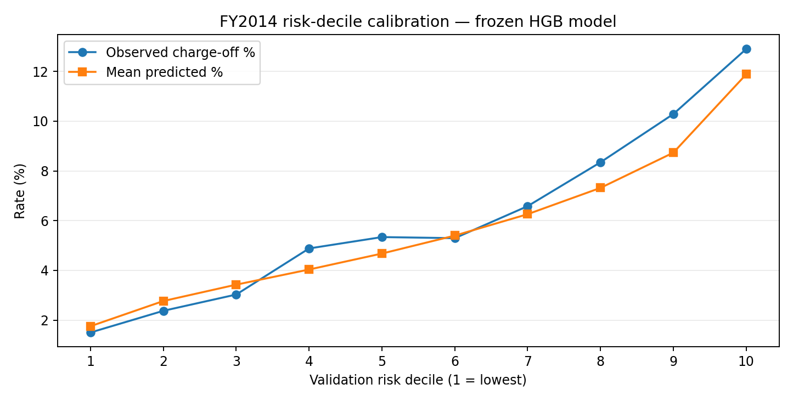

# SBA 7(a) Credit-Risk Analytics and Model Validation

**Technical report | Project A | 11 November 2026**  
**Release status:** Published retrospective research prototype. Independent raw-source-to-model reproduction is not yet verified. **Not for lending decisions.**

## Executive summary

This project examines whether variables in a public, historical U.S. Small Business Administration (SBA) 7(a) Freedom of Information Act (FOIA) extract can distinguish loans with a **retrospectively observed charge-off within 120 months of approval**. The focus is not solely prediction: the investigation addresses target construction, data integrity, chronological validation, feature provenance, unusually strong loan-term associations, calibration, and reproducibility.

The source is a **30 September 2026 retrospective SBA snapshot**, not an immutable approval-time feature store. From an audited FY2010–FY2014 population of **242,726 unique records** after removing **799 exact duplicate excess rows**, the established strict modeling cohort contains **210,516 loans**, including **13,634 charge-offs under the project’s fixed-horizon target**. These counts refer to different audit populations and should not be conflated.

The final development comparison fits **164,628 FY2010–FY2013 loans** (10,856 charge-off events) and evaluates on **45,888 FY2014 loans** (2,778 events; 6.05%). The provisional primary **Extended HistGradientBoosting** model achieves **0.1099 average precision (PR-AUC), 0.6695 ROC-AUC, and 0.05571 Brier score** on FY2014. An Extended Logistic Regression comparator achieves **0.1061, 0.6557, and 0.05587**, respectively. These are **development-validation results**, not unbiased performance estimates on a pristine holdout.

An unexpectedly strong association between recorded loan-term patterns and retrospective outcomes prompted a source-lineage and event-timing investigation. Term-derived predictors were **excluded conservatively** from the retained models. The analysis supports a useful research demonstration of risk ranking and model governance; it does **not** establish approval-time feature availability, causal relationships, deployment readiness, or generalization to all SBA originations.

## 1. Research question and scope

**Research question.** Among loans selected into a retrospectively defined, fixed-horizon SBA 7(a) cohort, how well can available recorded loan characteristics rank charge-off outcomes, and how do model choice, time period, data provenance, and calibration affect the interpretation?

The target is `target_chargeoff_within_120m`, referring to the project's established definition of charge-off within 120 months of approval. Eligibility uses historical statuses and follow-up criteria implemented by the cohort builder. Accordingly, the task is **retrospective outcome discrimination in a selected sample**, not an unbiased prospective loan-approval prediction problem. It is not appropriate to interpret the resulting probabilities as deployable applicant-level credit risk.

**Out of scope:** production underwriting, pricing, fairness certification, causal estimation of loan terms, automated credit decisions, or a claim that the full public SBA portfolio is represented by the strict cohort.

## 2. Data source, population and target design

The research uses the public SBA 7(a) FOIA data, with the local analysis tied to a **2026-09-30** extract. The full project includes public-data profiling, missingness checks, duplicate analysis, source comparisons, status and date diagnostics, cohort eligibility tests, and temporal splits. Only aggregate diagnostics and source code are published; raw source records and enriched loan-level cohorts remain outside GitHub.

| Population / quality checkpoint | Count | Meaning |
|---|---:|---|
| FY2010–FY2014 source rows before de-duplication | 243,525 | Rows in analysis window |
| Exact duplicate excess rows | 799 | Removed in source-lineage audit |
| Unique FY2010–FY2014 records | 242,726 | Audit population |
| Strict fixed-horizon modeling cohort | 210,516 | Retrospectively eligible loans |
| Charge-offs in the strict cohort | 13,634 | Fixed 120-month target events |
| FY2010–FY2013 fitting sample | 164,628 | 10,856 target events |
| FY2014 development validation | 45,888 | 2,778 events |

Cohort validity is a central limitation. Eligibility depends in part on retrospective status and term validity, creating possible **selection bias** even after the term predictor is removed. Changes to follow-up windows, observation origins, or eligibility rules can alter the population and target. As a sensitivity check, the earlier source-lineage audit found **50 different labels among 209,207 loans eligible under both approval-origin and first-disbursement-origin definitions**; the origin choice therefore requires explicit documentation rather than a silent substitution.

## 3. Quality control and suspicious term associations

### 3.1 Exact-term patterns

Early interpretability and ablation analyses identified a large relationship between `TermInMonths` and retrospective charge-off status. Within the strict FY2010–FY2014 cohort, term lengths divisible by 12 had **1,211 events among 169,825 loans (0.71%)**, compared with **12,423 among 40,691 loans (30.53%)** for other recorded term values. These are descriptive rates in a selected dataset, not causal effects, risk multipliers for an applicant, or evidence of a specific SBA policy.

The source-lineage audit checked term values as recorded, without rounding, and compared patterns across fiscal year, program/processing and revolving status. The unusual association remained a concern after these descriptive checks. The 5D.1 forensic investigation tested a possible mechanism: whether recorded terms approximately matched elapsed time until charge-off. The observed near-match frequencies were low and similar between term groups (within three months: about **4.15%** for nonmultiples and **3.58%** for multiples among records with observed charge-off events). This **weakens that specific event-time explanation**, but does not establish that the source term field is its unaltered value at original approval.

**Modeling decision:** omit `TermInMonths`, its divisibility indicator, and all other term-derived features from retained models. Exclude terminal status, outcome dates and other post-outcome variables from predictors as well. `BusinessAge` is also excluded from the frozen models while its historical collection/provenance questions remain open.

### 3.2 Missingness and field provenance

The published ten-feature register classifies **every retained predictor as provisionally not verified at the original decision time**. Names such as `initial_interest_rate` are not sufficient proof of historical availability. This is important because a 2026 administrative extract may contain amendments, reclassifications or other information that was not available at a prior loan approval. No independent contemporaneous underwriting record or archived origination snapshot is supplied to establish otherwise.

## 4. Modeling design

The analysis compares Logistic Regression, serving as an interpretable reference, with HistGradientBoosting, serving as a flexible nonlinear alternative. Model sets progress from a five-feature core to an extended set. A later exploratory set adds `BusinessAge` but is not selected as a frozen primary model given the provenance issue.

**Retained ten features:** `log_gross_approval`, `guarantee_share`, `initial_interest_rate`, `naics_sector`, `project_state`, `business_type`, `processing_method`, `revolver_status`, `fixed_or_variable_interest_ind`, and `collateral_ind`. Numeric and categorical preprocessing is fitted only on the corresponding training years; the FY2014 validation year is not used to fit imputers or transformations. Exact processing details are in [`scripts/sba_task5d2_term_free_validation.py`](../scripts/sba_task5d2_term_free_validation.py) and [`scripts/sba_task5e1_model_freeze.py`](../scripts/sba_task5e1_model_freeze.py).

**Chronological comparisons:** first fit FY2010–FY2012 and validate FY2013; then fit FY2010–FY2013 and validate FY2014. The final saved models are refitted using FY2010–FY2013 and their metrics are reproduced on FY2014. Because FY2013 and FY2014 inform development and model choice, these are not untouched confirmatory samples. FY2015–FY2016 outcomes were inspected earlier during baseline work and cannot be represented as a pristine holdout.

## 5. Results

### 5.1 Temporal validation

| Validation | Model | PR-AUC | ROC-AUC | Brier score | Observed event rate |
|---|---|---:|---:|---:|---:|
| FY2013 | Extended Logistic Regression | 0.0913 | 0.6346 | 0.05202 | 5.58% |
| FY2013 | Extended HistGradientBoosting | **0.0957** | **0.6469** | **0.05186** | 5.58% |
| FY2014 | Extended Logistic Regression | 0.1061 | 0.6557 | 0.05587 | 6.05% |
| FY2014 | Extended HistGradientBoosting | **0.1099** | **0.6695** | **0.05571** | 6.05% |

*Figure 1. Average precision/PR-AUC on the two development-validation years. Comparisons across years should account for different charge-off prevalence and cohort composition.*

The extended set performs better than the core set in FY2014 (for example, HistGradientBoosting PR-AUC rises from **0.0940 to 0.1099**). The best numerical exploratory performance was obtained with the `BusinessAge` feature, but the conservative frozen models use the extended **term-free, BusinessAge-free** set.

### 5.2 Statistical uncertainty

A paired bootstrap with **150 replicates** compared extended HistGradientBoosting minus extended Logistic Regression on each development-validation year. FY2014 differences and their approximate 95% bootstrap intervals are:

| Metric | HGB minus Logistic | 95% bootstrap interval | Interpretation |
|---|---:|---|---|
| PR-AUC | +0.0035 | -0.0004 to +0.0075 | Interval includes zero |
| ROC-AUC | +0.0139 | +0.0088 to +0.0186 | Positive in this procedure |
| Brier score | -0.00015 | -0.00022 to -0.00007 | Slightly lower error |

These intervals reflect resampling uncertainty within this retrospectively selected validation sample; they do **not** quantify historical feature revisions, time drift, selection effects, or policy deployment uncertainty. With only 150 draws, interval estimates also have Monte Carlo variability. The primary candidate is selected for its small, consistent discrimination/calibration advantage, not a claim of conclusively superior average precision in FY2014.

### 5.3 Risk ranking and calibration

In FY2014, observed charge-off prevalence was **6.0539%**. The frozen HistGradientBoosting model's mean prediction was **5.6254%**, an absolute gap of approximately **0.43 percentage points**. In its highest predicted-risk decile, observed charge-off frequency was approximately **12.90%**, versus **11.88%** predicted. This indicates informative ranking within the sample but **underprediction of observed risk**, with further variation across recorded subgroups.

*Figure 2. Risk-decile observed versus predicted frequencies for the frozen HistGradientBoosting model. This is development validation, not deployment calibration.*

For example, the FY2014 recorded business-age group of two to under three years had observed frequency around **8.62%** versus approximately **6.06%** predicted in the subgroup audit. This illustrates subgroup calibration limitations, **not** a fairness verdict. No decision threshold, default approval/denial action, or operational calibration adjustment is proposed.

## 6. Model freeze and reproducibility

The frozen release includes two serialized pipelines:

- [`models/B_extended_no_term_HistGradientBoosting.joblib`](../models/B_extended_no_term_HistGradientBoosting.joblib)
- [`models/B_extended_no_term_LogisticRegression.joblib`](../models/B_extended_no_term_LogisticRegression.joblib)

The official model-freeze manifest records **ten passing quality gates**, confirms that preprocessing used the fitting years only, checks that forbidden term and outcome variables are absent, and shows **zero difference between predictions before and after loading the saved models**. SHA-256 checksums are recorded for the cohort input and both models. Do not deserialize untrusted `joblib` files; such files can execute code on load.

The GitHub release includes model-comparison scripts, aggregate metrics, source lineage tests, the Task 4 enriched cohort builder, pinned package versions, and instructions in [`docs/REPRODUCE.md`](REPRODUCE.md). However, an **independent raw-FOIA-to-enriched-cohort-to-model rebuild has not been verified**. In particular, a rebuilt `.csv.gz` can differ at the compressed-byte level because gzip can embed metadata even if the underlying table is equivalent. The frozen run's hash guard expects the originally validated compressed input and must not be bypassed solely to obtain a passing label. The correct next verification is to compare canonical uncompressed data and rerun documented checks, while keeping the original official frozen artifact unchanged.

## 7. Interpretation, limitations, and responsible use

1. **Retrospective selection:** strict-cohort eligibility incorporates downstream information and may bias comparisons; performance does not generalize automatically to all origination applications.
2. **Feature timing:** none of the ten published predictors has a contemporaneous, independently verified approval-time value history. Exclusion of suspicious term predictors is precautionary, not proof the other inputs are safe.
3. **Development-only evaluation:** FY2013 and FY2014 guided choices; a previous baseline inspected FY2015–FY2016. No pristine test performance is claimed.
4. **Incomplete calibration:** average and top-decile risks are underestimated in FY2014, and subgroup gaps remain.
5. **Prediction is not causation:** neither the model nor the term investigation establishes a causal effect of loan terms, business characteristics, or program attributes.
6. **No operational decision use:** the score is inappropriate for approval, denial, pricing, regulatory compliance decisions, or individual risk guarantees.
7. **Reproduction is partial:** input-level source-to-model regeneration has been documented but not independently confirmed.

These limitations shape the appropriate contribution: a carefully audited, transparent **research and validation workflow** rather than a deployable credit-risk engine.

## 8. Conclusions and next research steps

The project demonstrates a defensible workflow for source auditing, suspicious-feature investigation, forward-year validation, uncertainty comparison, calibration review, model artifact freezing, and integrity-checked public documentation. On the selected retrospective FY2014 cohort, term-free extended HistGradientBoosting shows **moderate ranking performance**, with ROC-AUC around **0.670** and PR-AUC around **0.110**, alongside meaningful calibration gaps. The research value comes from diagnosing why an extremely strong predictor may be unsafe, documenting model limits, and preserving the evidence needed to challenge the results.

Highest-priority future work is (1) independently re-create the enriched cohort from the official source files using stable content hashes, (2) verify features against genuinely historical approval-time records, and (3) construct a redesigned origination-time cohort with an independent, sufficiently mature future evaluation sample. Additional hyperparameter experiments are not the immediate priority.

## Evidence and audit trail

All numerical results in this report were transcribed from the project's verified aggregate outputs and previously reviewed forensic archives. Main public repository references:

- [`results/task5e1_manifest.json`](../results/task5e1_manifest.json): frozen sample counts, metrics, model checksums and QA gates.
- [`results/task5e1_frozen_model_metrics.csv`](../results/task5e1_frozen_model_metrics.csv): final FY2014 metrics.
- [`results/task5d3_temporal_comparison.csv`](../results/task5d3_temporal_comparison.csv): FY2013/FY2014 forward-year comparisons.
- [`results/task5d3_paired_bootstrap.csv`](../results/task5d3_paired_bootstrap.csv): paired bootstrap uncertainty.
- [`results/task5d2_model_comparison.csv`](../results/task5d2_model_comparison.csv): core, extended and exploratory feature sets.
- [`results/task5e1_feature_provenance_register.csv`](../results/task5e1_feature_provenance_register.csv): point-in-time caveats.
- [`docs/METHODOLOGY.md`](METHODOLOGY.md), [`docs/MODEL_CARD.md`](MODEL_CARD.md) and [`docs/OPEN_QUESTIONS.md`](OPEN_QUESTIONS.md): methods, intended use and unresolved issues.
- Source-lineage/term-forensics outputs: previously inspected Task 5D / 5D.1 audit ZIP archives; these aggregate diagnostics are **not yet included** in the public release. Claims relying on them should be read with that provenance caveat.

**Data reference:** [U.S. Small Business Administration, 7(a) and 504 FOIA data](https://data.sba.gov/dataset/7a-504-foia), locally analysed as of 30 September 2026. **Report version:** v1.0, 11 November 2026.
